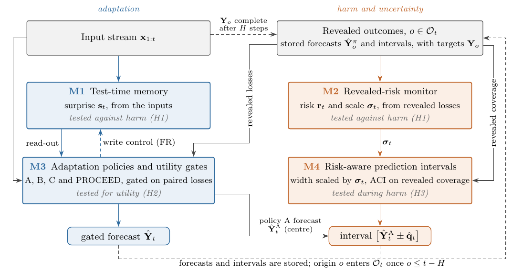
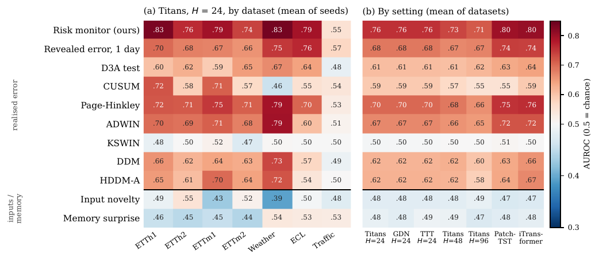

# Change Is Not Harm

Official code for the paper

> **Change Is Not Harm: Surprise, Risk and Adaptation Utility in Test-Time Memory for Online Forecasting**
> Humam Alkaabi. Submitted to *Neural Networks*.

Test-time memories such as Titans write more strongly when an input is surprising, which makes surprise a tempting
signal of when an online forecaster is in difficulty. The paper separates three quantities that this conflates:
**change** in the inputs, **harm** to forecast accuracy and the **utility** of adapting. It defines all three under
delayed (completed-horizon) feedback, proves that none implies another, and tests on seven benchmarks whether memory
surprise anticipates harm, whether the utility of adapting can be predicted, and whether intervals scaled by revealed
risk protect against harm.

<p align="center">
  <br>
  <em>The four components under completed-horizon feedback: memory surprise (M1), the revealed-risk monitor (M2),
  utility gates over concurrent policies (M3) and risk-scaled prediction intervals (M4).</em>
</p>

## Main results

| Hypothesis | Pre-specified rule | Runs meeting it (Titans, $H=24$) |
|---|---|---|
| H1 | revealed risk anticipates harm better than memory surprise | 16 / 19 |
| H1 | the upper 95% bound of the AUROC of surprise is below 0.55 | 7 / 19 |
| H2 | past paired losses are equivalent to chance in predicting utility (TOST) | 76 / 114 comparisons |
| H2 | every utility gate stays within 0.5% of the static average | 0 / 19 |
| H3 | risk-scaled ACI raises coverage during harm | 19 / 19 |
| H3 | its Winkler ratio to ACI stays below 1.05 | 11 / 19 |

<p align="center">
  
</p>

The surprise of an instance-normalised memory is close to chance as a signal of harm (AUROC 0.40 to 0.57), while
the forecaster's own revealed losses anticipate the continuation of harm on six of seven datasets (mean AUROC 0.74
to 0.83). The full results, every post hoc analysis and every departure from the pre-specified design are reported
in the paper and its Supplementary Material.

## Repository structure

```
harm-gated-memory/
├── main.py                    single entry point for every experiment, table and figure
├── hgm/                       the library
│   ├── data.py                datasets and the chronological 20:5:75 split of OnlineTSF
│   ├── prepare.py             downloads and the set-up of OnlineTSF (PROCEED) and TCPD
│   ├── train.py               pre-training of the plain and memory forecasters
│   ├── online.py              the delayed-feedback online protocol
│   ├── baselines.py           Online-GD and PROCEED with an RLinear backbone, L = 336
│   ├── paths.py               every file location in one place
│   ├── models/                memory (Titans, Gated DeltaNet, TTT-Linear, deep memory),
│   │                          forget-and-recall controller, forecaster, PatchTST and iTransformer
│   ├── monitors/              harm labels, revealed-risk monitor, drift detectors, memory streams
│   ├── policies/              policies A, B and C; Hedge, LCB and Bayesian utility gates
│   ├── uncertainty/           split conformal, ACI, risk-scaled ACI, Bayesian intervals
│   ├── experiments/           one module per experiment of the paper (H1, H2, H3 and controls)
│   └── analysis/              statistics (block bootstrap, TOST, Holm), tables and figures
├── tests/                     causality of every online decision rule; split boundaries
├── scripts/                   run everything, reproduce the paper, export results
├── data/                      datasets (downloaded by `python main.py setup`)
├── third_party/               patches applied to OnlineTSF for PROCEED
├── checkpoints/               pre-trained forecasters (seeds 1 to 3; H = 24, 48, 96)
├── outputs/                   per-run results; tables/ and figures/ are generated
└── assets/                    images of this README
```

The code keeps the numbering of the working plan: its hypotheses **H5, H6 and H7 are H1, H2 and H3** of the paper.

## Installation

Python 3.10 or later.

```bash
git clone https://github.com/humamalkaabi/harm-gated-memory.git
cd harm-gated-memory
pip install -r requirements.txt
python main.py setup          # datasets, OnlineTSF with our patches, TCPD (resumable)
```

## Data

| Dataset | Variates | Frequency | Source |
|---|---|---|---|
| ETTh1, ETTh2, ETTm1, ETTm2 | 7 | 1 hour / 15 minutes | [ETDataset](https://github.com/zhouhaoyi/ETDataset) |
| Weather | 21 | 10 minutes | Max Planck Institute for Biogeochemistry, Jena, as distributed with Autoformer |
| ECL | 321 | 1 hour | [multivariate-time-series-data](https://github.com/laiguokun/multivariate-time-series-data) (UCI) |
| Traffic | 862 | 1 hour | [multivariate-time-series-data](https://github.com/laiguokun/multivariate-time-series-data) (PeMS) |
| TCPD | univariate | various | [Turing Change Point Dataset](https://github.com/alan-turing-institute/TCPD) |

`python main.py setup` downloads every dataset into `data/raw/` except Weather, which is included. See
[`data/README.md`](data/README.md).

## Reproducing the paper

**Tables and figures from the saved results** (a few minutes, no training):

```bash
python main.py reproduce      # or: bash scripts/reproduce_paper.sh
```

The per-run results are stored in `outputs/` (results, summaries and small per-run arrays) and the pre-trained
forecasters in `checkpoints/`. This writes every table of the paper to `outputs/tables/` and every figure to `outputs/figures/`, with a report in
`outputs/reproduce_report.txt`.

**All experiments from scratch** (several days on one laptop CPU; every step is resumable):

```bash
bash scripts/run_all.sh       # in the background; follow with: tail -f outputs/logs/run_all.log
```

or step by step:

| Command | Paper |
|---|---|
| `python main.py main` | main runs: Titans memory, $H=24$, seven datasets (Sections 5.1 to 5.4) |
| `python main.py generality` | Gated DeltaNet, TTT-Linear, $H=48$ and 96 (Section 5.5) |
| `python main.py robustness` | policy A on PatchTST and iTransformer (Section 5.5) |
| `python main.py delayed` | controlled change, Proposition 3 (Section 5.1) |
| `python main.py tcpd` | annotated change points (Section 5.1) |
| `python main.py posthoc` | every post hoc analysis (Section 5.2 and Supplementary Material) |

**A single run:**

```bash
python main.py train     --data ETTh2 --seed 1 --kind plain
python main.py train     --data ETTh2 --seed 1 --kind mem
python main.py proceed   --data ETTh2
python main.py policies  --data ETTh2 --seed 1
python main.py evaluate  --data ETTh2 --seed 1     # H1, H2, H3 and their decision rules
python main.py --help                              # every command
```

In Spyder, open `main.py`, set `SPYDER_COMMAND` and press Run.

**Tests:**

```bash
python -m tests.causality         # every H2 rule uses only revealed outcomes
python tests/split_boundaries.py  # no target window crosses a split, except the documented deviation
```

## Acknowledgements

PROCEED and Online-GD are run with [OnlineTSF](https://github.com/SJTU-DMTai/OnlineTSF), with the patches in
`third_party/onlinetsf_patches/`. The drift detectors are those of [River](https://riverml.xyz) 0.26.1, and the
annotated change points come from [TCPD](https://github.com/alan-turing-institute/TCPD).

## Citation

```bibtex
@article{alkaabi2026change,
  title   = {Change Is Not Harm: Surprise, Risk and Adaptation Utility in Test-Time Memory for Online Forecasting},
  author  = {Alkaabi, Humam},
  journal = {Neural Networks},
  note    = {Under review},
  year    = {2026}
}
```

## License

Released under the [MIT License](LICENSE).
